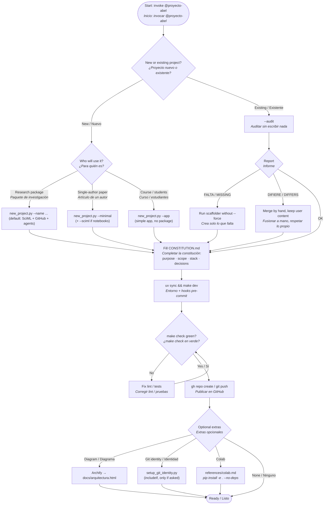
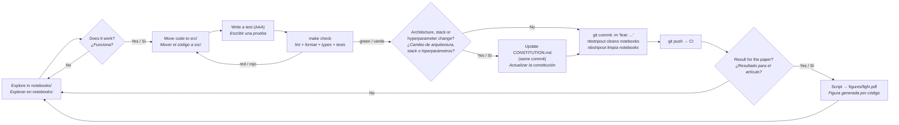

# Workflow / Flujo de trabajo

Two diagrams: **(1)** how the skill sets up a project, **(2)** the daily research loop once
the project exists. Each node is bilingual: **English** / *Español*.

Dos diagramas: **(1)** cómo el skill configura un proyecto y **(2)** el ciclo diario de
investigación una vez el proyecto existe.

## 1 · Setting up a project / Configurar un proyecto

## 2 · Daily research loop / Ciclo diario de investigación

> GitHub renderiza Mermaid directamente. Copias en SVG para diapositivas y una página
> interactiva EN/ES están en la carpeta `docs/` del repositorio del skill.
> Para re-exportar tras editar: `npx -y @mermaid-js/mermaid-cli -i workflow.md -o workflow.svg`.
